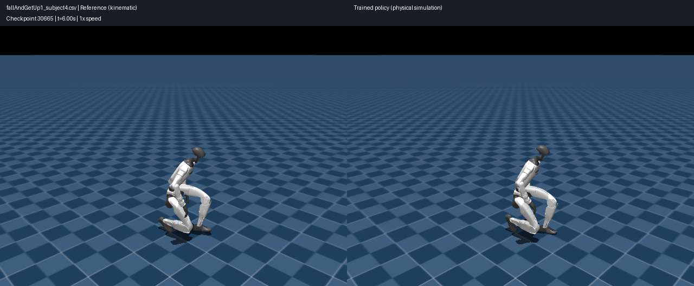
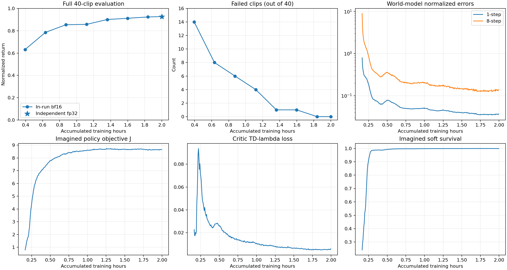
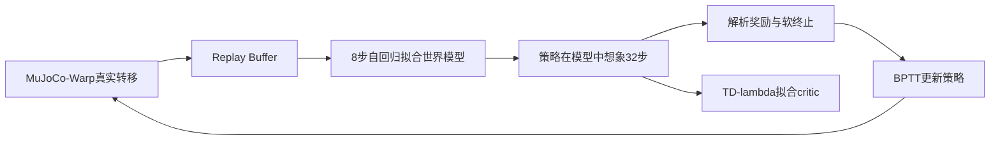

# SuperMimic · LAFAN1 Reproduction

**基于可微世界模型与 BPTT 的人形机器人动作模仿：实验复现、核验脚本与结果展示。**

[演示页面](https://yued2013-hash.github.io/supermimic-lafan1-reproduction/) · [48秒仿真视频](docs/media/demo.mp4) · [实验报告](docs/experiment.md) · [40条动作评估](results/lafan1_seed0/per_clip.csv) · [复现步骤](docs/reproduce.md) · [实现与贡献](CONTRIBUTIONS.md)



## 结果

| 项目 | 实测 |
| :-- | :-- |
| GPU | 单卡 RTX4090 24GB |
| 训练 | 从随机初始化联合训练世界模型、策略与 critic |
| 并行环境 | 4096 |
| 累计训练计时 | 7200.17秒，约2小时；不含全部启动/评估/保存开销 |
| 最终迭代 / 策略更新 | 30,665 / 12,266 |
| 真实仿真环境步 | 125,865,984 |
| 动作库 | LAFAN1 G1重定向，40条长序列、441,120帧、50Hz，约2.45小时 |
| 独立FP32完整评估 | **40/40完成，0失败** |
| 平均归一化回报 | **0.927108** |
| 按帧加权回报 | 0.928948 |

**口径：单seed、训练动作库上的完整跟踪评估。** 不代表未见动作泛化、多seed稳定性或真实机器人性能。原命令迭代上限320k，本次达到2小时预算后正常结束，实际运行30,665次迭代。



## 实验内容与实现来源

本项目记录指定第三方实现的环境配置、数据准备、随机初始化训练、checkpoint保存/加载、独立FP32评估、物理轨迹与视频导出。仓库提供**独立编写的运行与核验脚本、实验配置和结果记录**；训练框架来自下述固定版本的第三方实现。

- 论文：[SuperMimic](https://arxiv.org/abs/2610.28480)，[官方项目页](https://supermimic.github.io/)。
- 实际训练代码：[Shimingyi/allmimic](https://github.com/Shimingyi/allmimic/tree/cb334ff674b2f57248f33f8c21b7fb526fbdf8cc)，固定commit `cb334ff674b2f57248f33f8c21b7fb526fbdf8cc`。
- 动作来源：[LAFAN1 Retargeting Dataset](https://huggingface.co/datasets/lvhaidong/LAFAN1_Retargeting_Dataset)，固定revision与逐文件SHA见 [data_manifest.json](results/lafan1_seed0/data_manifest.json)。
- 上游包含社区改动，见配置中的 recommended preset；本结果不宣称严格对齐论文全部实现或基准。

## 方法理解



策略更新期间冻结世界模型网络参数，但保留动作→状态→奖励的导数。优化通过学习到的世界模型反传，无需对物理模拟器本身求导。世界模型使用绝对setpoint动作，与策略输出的残差动作区分；奖励、观测和终止在当前实现中解析计算。

## 无GPU快速核验

```bash
git clone https://github.com/yued2013-hash/supermimic-lafan1-reproduction.git
cd supermimic-lafan1-reproduction
python scripts/verify_results.py
python -m unittest discover -s tests -v
```

主核验流程只用Python标准库；准备测试中的坐标检查可选NumPy（未安装时跳过）。上述命令核对40条唯一动作、完整步数、回报统计和训练记录，不启动训练。真实世界模型诊断需要额外的CPU或GPU依赖。

## 重新训练与评估

需要Linux/NVIDIA GPU，并独立安装实际训练代码要求的依赖。实际环境记录见 [environment](environment/)，具体步骤见 [复现步骤](docs/reproduce.md)。本仓库不自动修改驱动或安装上游依赖。

```bash
# CODE_DIR为按固定commit检出的allmimic目录；数据由独立下载/转换步骤生成。
bash scripts/train.sh "$CODE_DIR" "$DATA_NPZ" "$OUTPUT_DIR"
bash scripts/evaluate.sh "$CODE_DIR" "$CHECKPOINT" "$LIBRARY_DIR" "$EVAL_OUTPUT_DIR"
```

完整40条原始动作、50Hz物理回放、40条完整视频、最终及7个中间checkpoint已做本地独立备份与哈希核验。本公开仓库提供代表视频、全40项指标、日志与配置；**不包含原始动作文件、机器人资产、上游源代码或大体积权重**。

## 后续实验设计

[H=16/32想象长度对照](docs/horizon_ablation.md)发现策略loss除H与固定梯度裁剪存在耦合。独立源码准备、640窗口统一诊断及真实checkpoint的CPU检查已完成，见 [CPU准备验收](docs/cpu_preparation.md)。两组新训练与GPU编译验证尚未运行，不将原模型诊断作为新消融性能结果。

## 已知限制

- 专门的compiled-BPTT完整一致性测试曾在900秒限制下超时，exit124；不能声称该测试通过。正式训练完成与该项测试结论分开陈述。
- 沿用上游评估配置，包括其已知约束池容量限制；未通过修改物理参数追求分数。
- 未做与不同实现/评估协议的公平性能对比，不将论文的加速比或实机结果写成本项目成果。

## 授权与致谢

上游固定commit的LICENSE说明再分发授权尚未明确，因此此仓库不重新分发其训练源代码；数据与机器人资产沿用各自条款。见 [第三方说明](THIRD_PARTY_NOTICES.md)。本仓库暂未为独立材料选择通用开源许可证，不应把上游占位LICENSE视为MIT授权。
