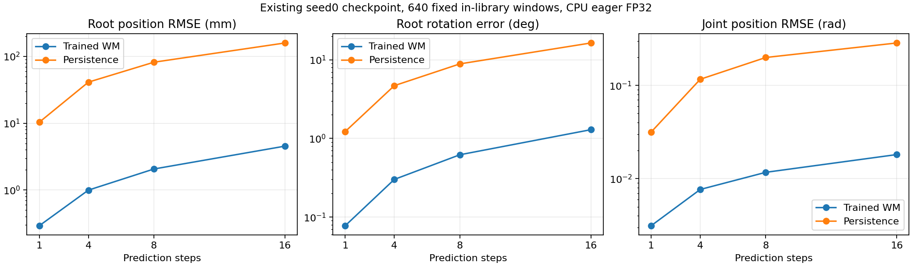

# CPU准备验收：损失缩放与共同模型诊断

2026-10-29。**本地准备完成；没有运行H16/H32新训练，也没有GPU编译一致性结论。**

## 已完成

- 依据上游train.py的固定SHA，在独立本地副本只把策略loss除数固定为32。原文件SHA与修改后SHA见 [horizon_patch.json](../results/diagnostics/horizon_patch.json)。
- 原40条物理回放每条固定抽取16个窗口，seed20261029，总640窗口；每个窗口有17个状态和16个绝对setpoint动作，不跨终态。样本索引与源文件SHA见 [diagnostic_manifest.json](../results/diagnostics/diagnostic_manifest.json)。
- 将MuJoCo局部根角速度转换为世界坐标，保留state71布局；xi由原固定评估协议重建为friction1、零encoder bias及零COM offset，不伪称从任意训练随机化状态恢复。
- 加载真实最终checkpoint，复用上游的世界模型、状态特征、运动学及state_error。CPU路径不构造模拟器、不调用Warp、不执行训练。
- 在8个输入状态上独立对照MuJoCo和FastTreeKinematics的**位姿**，最大位置绝对误差约4.22e-07m，旋转矩阵最大绝对误差约1.98e-07。
- 完整640窗口跑通1/4/8/16步开放环预测；每步使用记录动作，不刷新为真值状态，包含逐动作指标与persistence基线。
- 11项准备/证据测试通过，包括固定除数补丁保护、错误源拒绝、局部→世界角速度、无效四元数及错误训练输入类型。

## 原有模型的诊断结果

这是**迭代30665、训练H32的原有模型**，不是8000次迭代的H16/H32对照。数据来自训练动作库、由原模型对应策略产生的已归档轨迹，不能作为未见动作或独立策略分布泛化结果。

| 预测步数 | 根位置RMSE mm | 根旋转平均误差 deg | 关节位置RMSE rad |
| --: | --: | --: | --: |
| 1 | 0.292 | 0.078 | 0.00313 |
| 4 | 0.997 | 0.301 | 0.00767 |
| 8 | 2.065 | 0.620 | 0.01171 |
| 16 | 4.540 | 1.292 | 0.01815 |



完整数值见 [baseline_seed0_cpu.json](../results/diagnostics/baseline_seed0_cpu.json)。物理单位指标为主；额外common_scaled_mse使用**同一固定诊断真值的一步增量标准差**，下限1e-3，不使用各checkpoint自己的误差归一化器。这个指标不是训练中的wm_loss/wm_errk，二者数值不能直接比较。

根位置RMSE对样本与三个坐标的平方误差取平均后开根；旋转指标为相对旋转测地角的样本均值。共同尺度统一在CPU计算，再用于模型诊断，避免因GPU归约改变尺度。`prediction_seconds`只是本地诊断循环计时，不能作为GPU训练吞吐或H16/H32训练耗时的结论。

## 缩放检查覆盖什么

在真实冻结世界模型上，用两个输入状态构造动作偏移参数，通过16/32步状态链反传一个平滑测试目标。检查 `grad(-J/D) == grad(-J)/D`、PyTorch范数裁剪上限，并进行动作方向中心有限差分；最大相对误差约 **0.213%**。H32超过16步时重复最后一个已记录动作，只用于合成梯度检查，没有将其算作真实诊断轨迹。

见 [loss_scaling_cpu_probe.json](../results/diagnostics/loss_scaling_cpu_probe.json)。这是**动作参数与测试目标**的WM链检查，不是实际策略参数、解析任务奖励、critic bootstrap、Adam更新或torch.compile/GPU梯度检查。因此没有解除此前compiled-BPTT测试超时留下的验证缺口。

## 环境与数据留存

本轮使用独立本地Python3.12.14环境、torch2.14.1+cpu、MuJoCo3.5.0、mjlab1.2.0资产及NumPy2.4.6。CPU运行只有mjlab资产wheel，未安装其完整训练依赖；不将它作为可运行GPU训练环境。没有修改系统Python或Conda base。

诊断NPZ SHA256：`90aadacc035c60ebfa9feac5740aed61a7dba86b143a718d5fe254d69cb046da`。固定状态/动作文件保存在私有本地归档，不直接放入Git；公开来源索引、哈希、方法及聚合/逐动作误差。后续对照应传输并复用同一文件，避免分别重采样。

## 在新GPU实例上的下一步

1. 恢复独立训练环境、原始数据和固定版本源码，创建同样的受控源码副本。
2. H16/H32各跑50迭代smoke，核对优化更新、有限日志、checkpoint保存/加载及实际目标的梯度。
3. 在同一诊断文件上检查GPU eager误差、运行模式和共同尺度哈希；另外验证编译梯度。
4. 通过后再在同一实例运行两组8000迭代，独立FP32评估完整40动作，并比较共同样本上的模型误差与总进程/训练耗时。

### 命令示例

```bash
python scripts/prepare_horizon_source.py --upstream "$UPSTREAM" --output "$CONTROLLED_CODE"
python scripts/prepare_wm_diagnostic.py --rollouts "$ARCHIVED_FULL40" --output "$DIAGNOSTIC_NPZ"
python scripts/check_loss_scaling.py --code "$CONTROLLED_CODE" --checkpoint "$CHECKPOINT" --dataset "$DIAGNOSTIC_NPZ" --out "$LOSS_REPORT"
python scripts/evaluate_wm_diagnostic.py --code "$CONTROLLED_CODE" --checkpoint "$CHECKPOINT" --dataset "$DIAGNOSTIC_NPZ" --out "$MODEL_REPORT" --device cpu

# 默认只打印命令，不产生GPU任务；真正运行需显式增加 --execute。
python scripts/run_horizon.py --code "$CONTROLLED_CODE" --motions "$MOTION_LIBRARY" --out "$SMOKE_OUTPUT" --horizon 16 --smoke
```

CPU复核的最小安装可使用独立venv，先安装固定torch CPU wheel、numpy2.4.6和mujoco3.5.0，再用 `pip install --no-deps mjlab==1.2.0` 仅取得资产。GPU训练必须安装上游完整依赖，不能照搬这个资产专用的CPU环境。
