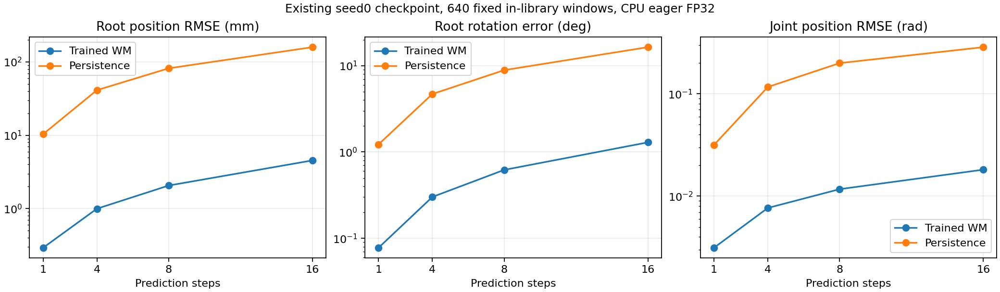

# CPU世界模型诊断与损失缩放分析

2026-10-29。完成固定源码补丁、共同诊断数据构建、最终checkpoint的CPU开放环预测与链式梯度检查。

## 已完成

- 依据上游train.py的固定SHA，在独立本地副本只把策略loss除数固定为32。原文件SHA与修改后SHA见 [horizon_patch.json](../results/diagnostics/horizon_patch.json)。
- 原40条物理回放每条固定抽取16个窗口，seed20261029，总640窗口；每个窗口有17个状态和16个绝对setpoint动作，不跨终态。样本索引与源文件SHA见 [diagnostic_manifest.json](../results/diagnostics/diagnostic_manifest.json)。
- 将MuJoCo局部根角速度转换为世界坐标，保留state71布局；xi由原固定评估协议重建为friction1、零encoder bias及零COM offset，对应固定评估物理上下文。
- 加载真实最终checkpoint，复用上游的世界模型、状态特征、运动学及state_error。CPU路径直接运行世界模型、运动学和误差计算。
- 在8个输入状态上独立对照MuJoCo和FastTreeKinematics的**位姿**，最大位置绝对误差约4.22e-07m，旋转矩阵最大绝对误差约1.98e-07。
- 完整640窗口跑通1/4/8/16步开放环预测；每步使用记录动作，不刷新为真值状态，包含逐动作指标与persistence基线。
- 11项准备/证据测试通过，包括固定除数补丁保护、错误源拒绝、局部→世界角速度、无效四元数及错误训练输入类型。

## 原有模型的诊断结果

诊断对象为**迭代30665、训练想象长度H32的最终世界模型**。输入取自该策略在LAFAN1训练动作库上的归档物理回放，共640个固定窗口。

| 预测步数 | 根位置RMSE mm | 根旋转平均误差 deg | 关节位置RMSE rad |
| --: | --: | --: | --: |
| 1 | 0.292 | 0.078 | 0.00313 |
| 4 | 0.997 | 0.301 | 0.00767 |
| 8 | 2.065 | 0.620 | 0.01171 |
| 16 | 4.540 | 1.292 | 0.01815 |



完整数值见 [baseline_seed0_cpu.json](../results/diagnostics/baseline_seed0_cpu.json)。物理单位指标为主；额外common_scaled_mse使用**同一固定诊断真值的一步增量标准差**，下限1e-3，不使用各checkpoint自己的误差归一化器。该共同尺度指标用于跨检查点模型误差分析，训练日志中的wm_loss/wm_errk另用运行中的归一化统计。

根位置RMSE对样本与三个坐标的平方误差取平均后开根；旋转指标为相对旋转测地角的样本均值。共同尺度统一在CPU计算，再用于模型诊断，避免因GPU归约改变尺度。`prediction_seconds`记录CPU诊断循环的耗时。

## 缩放检查覆盖什么

在真实冻结世界模型上，用两个输入状态构造动作偏移参数，通过16/32步状态链反传一个平滑测试目标。检查 `grad(-J/D) == grad(-J)/D`、PyTorch范数裁剪上限，并进行动作方向中心有限差分；最大相对误差约 **0.213%**。H32超过16步时重复最后一个已记录动作，用于构造32步链式梯度测试输入。

见 [loss_scaling_cpu_probe.json](../results/diagnostics/loss_scaling_cpu_probe.json)。该检查以**动作偏移参数与平滑目标**测量世界模型状态链的autograd、梯度缩放、范数裁剪与方向有限差分一致性。

## 环境与数据留存

本轮使用独立本地Python3.12.14环境、torch2.14.1+cpu、MuJoCo3.5.0、mjlab1.2.0资产及NumPy2.4.6。CPU环境安装mjlab资产wheel以加载运动学资源，依赖与GPU训练环境分别记录。

诊断NPZ SHA256：`90aadacc035c60ebfa9feac5740aed61a7dba86b143a718d5fe254d69cb046da`。固定状态/动作文件保存在私有本地归档，不直接放入Git；公开来源索引、哈希、方法及聚合/逐动作误差。后续对照应传输并复用同一文件，避免分别重采样。

## 工具使用

### 命令示例

```bash
python scripts/prepare_horizon_source.py --upstream "$UPSTREAM" --output "$CONTROLLED_CODE"
python scripts/prepare_wm_diagnostic.py --rollouts "$ARCHIVED_FULL40" --output "$DIAGNOSTIC_NPZ"
python scripts/check_loss_scaling.py --code "$CONTROLLED_CODE" --checkpoint "$CHECKPOINT" --dataset "$DIAGNOSTIC_NPZ" --out "$LOSS_REPORT"
python scripts/evaluate_wm_diagnostic.py --code "$CONTROLLED_CODE" --checkpoint "$CHECKPOINT" --dataset "$DIAGNOSTIC_NPZ" --out "$MODEL_REPORT" --device cpu

# 默认只打印命令，不产生GPU任务；真正运行需显式增加 --execute。
python scripts/run_horizon.py --code "$CONTROLLED_CODE" --motions "$MOTION_LIBRARY" --out "$SMOKE_OUTPUT" --horizon 16 --smoke
```

CPU复核的最小安装可使用独立venv，先安装固定torch CPU wheel、numpy2.4.6和mujoco3.5.0，再用 `pip install --no-deps mjlab==1.2.0` 仅取得资产。GPU训练使用上游完整依赖配置，CPU诊断使用上述资产与数学依赖配置。
